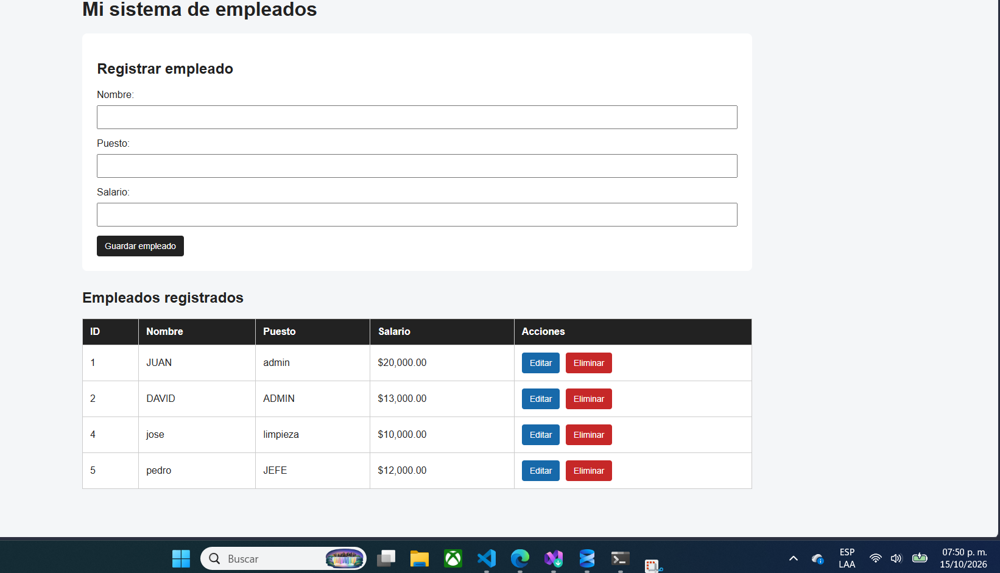

# Sistema de Gestión de Empleados

Aplicación web CRUD desarrollada con **Python, Flask y Microsoft SQL Server** para administrar la información de empleados desde una interfaz web.

Este proyecto permite practicar el desarrollo backend, la conexión a bases de datos relacionales y la creación de aplicaciones web con operaciones CRUD.
## Vista previa del sistema

## Funcionalidades

- **Registrar:** agregar nuevos empleados.
- **Consultar:** visualizar los empleados registrados.
- **Actualizar:** editar los datos de un empleado.
- **Eliminar:** borrar registros de empleados.
- **Persistencia de datos:** almacenar la información en Microsoft SQL Server.

## Tecnologías utilizadas

- Python
- Flask
- Microsoft SQL Server
- pyodbc
- HTML y CSS
- Git y GitHub

## Requisitos previos

Antes de ejecutar el proyecto, necesitas instalar:

- Python.
- Microsoft SQL Server Express.
- SQL Server Management Studio (SSMS), para administrar la base de datos.
- Microsoft ODBC Driver for SQL Server.
- Git.

## Configuración e instalación

### 1. Clonar el repositorio

```bash
git clone https://github.com/JuanEduardoRG/sistema-crud-empleados.git
cd sistema-crud-empleados
```

### 2. Crear un entorno virtual

```bash
python -m venv venv
```

### 3. Activar el entorno virtual

En Windows con Git Bash:

```bash
source venv/Scripts/activate
```

### 4. Instalar las dependencias

```bash
pip install -r requirements.txt
```

### 5. Configurar SQL Server

Asegúrate de que SQL Server esté instalado y que exista la base de datos `EmpresaDB`, con la tabla `Empleados`.

La aplicación utiliza autenticación de Windows para conectarse a la instancia local de SQL Server. Si tu instancia tiene otro nombre, ajusta la configuración de conexión en el código.

### 6. Ejecutar la aplicación

```bash
python app_flask.py
```

Abre en tu navegador:

http://127.0.0.1:5000

## Estructura del proyecto

```text
sistema-crud-empleados/
├── app_flask.py
├── app.py
├── probar_conexion.py
├── requirements.txt
├── README.md
└── .gitignore
```

## Objetivo del proyecto

Proyecto de práctica orientado al desarrollo web backend, la integración con bases de datos SQL y el uso de Git y GitHub para el control de versiones.

## Autor

Juan Eduardo Rodríguez García

GitHub: [JuanEduardoRG](https://github.com/JuanEduardoRG)